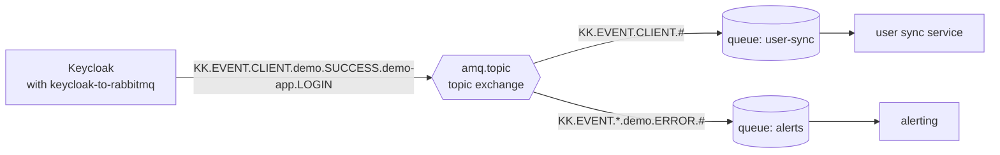

# keycloak-event-listener-rabbitmq

Publish Keycloak user and admin events to RabbitMQ, so your services can react to logins, registrations and account
changes as they happen.

[](https://github.com/efim0v/keycloak-event-listener-rabbitmq/actions/workflows/ci.yml)
[](https://github.com/efim0v/keycloak-event-listener-rabbitmq/releases/latest)
[](#compatibility)
[](License.md)
<!-- keycloak-latest: add when .github/workflows/keycloak-latest.yml has run on master
[](https://github.com/efim0v/keycloak-event-listener-rabbitmq/actions/workflows/keycloak-latest.yml)
-->

A maintained fork of [aznamier/keycloak-event-listener-rabbitmq](https://github.com/aznamier/keycloak-event-listener-rabbitmq)
for Keycloak 26. Consumers written for the original 3.0.5 release keep working: the routing keys, properties and JSON
fields are the same.

**[Quick start](#quick-start)** ·
[Installation](docs/installation.md) ·
[Configuration](docs/configuration.md) ·
[Message format](docs/message-format.md) ·
[Consumers](docs/consumers.md) ·
[Migration](docs/migration.md) ·
[Operations](docs/operations.md) ·
[FAQ](#faq)

## What it does



- Keycloak hands every user event (`LOGIN`, `LOGOUT`, `REGISTER`, `LOGIN_ERROR`, …) and every admin event (user
  created, role granted, client changed, …) of a realm to the listener, once you enable it in that realm.
- After Keycloak commits the request, the listener publishes one JSON message per event to an exchange, `amq.topic`
  by default, with a routing key such as `KK.EVENT.CLIENT.<realm>.<SUCCESS|ERROR>.<client>.<event type>`.
- Each consumer binds its own queue with the keys it needs: everything, one realm, only errors, only admin changes.

## Why this fork

- **Current Keycloak.** Upstream's last release, 3.0.5 (March 2024), was built against Keycloak 21.1.2. This fork is
  built against Keycloak 26.8.1, and CI runs an integration test (real Keycloak and RabbitMQ containers, the built
  jar) on Keycloak 26.8.1 and 26.0.8 for every change and every week.
- **Drop-in for consumers.** Same provider id `keycloak-to-rabbitmq`, same settings and environment variables, same
  Java class names in `@class` and `__TypeId__`, same routing keys and JSON fields as 3.0.5 on the same Keycloak
  version. Contract tests written against 3.0.5 before any change pin the format.
- **Security fixes** ([CHANGELOG](CHANGELOG.md#400-efim0v1---2026-10-15)): `amqp-client` 5.14.2 → 5.37.0, which
  closes 11 published advisories; TLS verifies the broker certificate and host name and never falls back to plain
  text; trust store and key store passwords are no longer logged.
- **A clean jar.** Only the listener and the RabbitMQ client. SLF4J and Netty are not bundled, so they do not clash
  with Keycloak's own copies.
- **Verifiable releases.** Built by CI from the tag, published with a SHA-256 checksum; the build is reproducible.

The original listener is the work of [aznamier](https://github.com/aznamier) and the upstream contributors
([credits](#license-and-credits)).

## Quick start

Keycloak, RabbitMQ and the listener with Docker Compose, ready in about half a minute once the images are pulled:

```sh
git clone https://github.com/efim0v/keycloak-event-listener-rabbitmq.git
cd keycloak-event-listener-rabbitmq/examples/docker-compose
docker compose up -d --wait
```

Log in as the demo user `alice`, then read the event back from the queue `keycloak-events`:

```sh
curl -s -o /dev/null -w '%{http_code}\n' \
  -d client_id=demo-app -d username=alice -d password=alice -d grant_type=password \
  http://localhost:8080/realms/demo/protocol/openid-connect/token

curl -s -u demo:demo -H 'content-type: application/json' \
  -d '{"count":1,"ackmode":"ack_requeue_false","encoding":"auto"}' \
  http://localhost:15672/api/queues/%2F/keycloak-events/get
```

The second command prints the message: routing key `KK.EVENT.CLIENT.demo.SUCCESS.demo-app.LOGIN`, the AMQP properties
and the JSON event. You can also log in at http://localhost:8080/realms/demo/account and look at the queue in the
RabbitMQ UI at http://localhost:15672 (`demo` / `demo`). `docker compose down -v` removes everything. Details:
[examples/docker-compose](examples/docker-compose/).

## Installation

1. Download the jar and its checksum from the [latest release](https://github.com/efim0v/keycloak-event-listener-rabbitmq/releases/latest)
   and check it:

   ```sh
   VERSION=4.1.0
   BASE=https://github.com/efim0v/keycloak-event-listener-rabbitmq/releases/download/v$VERSION
   curl -fLO "$BASE/keycloak-to-rabbit-$VERSION.jar"
   curl -fLO "$BASE/keycloak-to-rabbit.sha256"
   sha256sum --check keycloak-to-rabbit.sha256    # macOS: shasum -a 256 --check keycloak-to-rabbit.sha256
   ```

2. Put the jar into Keycloak's `providers/` directory (`/opt/keycloak/providers/` in the container image), and remove
   any older `keycloak-to-rabbit` jar. Run `kc.sh build` if you start Keycloak with `--optimized`.
3. [Configure](#configuration) the connection to RabbitMQ and restart Keycloak.
4. [Enable the listener](#enable-the-listener-in-a-realm) in each realm.

[docs/installation.md](docs/installation.md) has a Dockerfile for an optimized Keycloak image that checks the jar's
checksum while building, and examples for the Keycloak Operator and Helm charts<!-- provider-image -->, including an
init container with the provider image `ghcr.io/efim0v/keycloak-to-rabbit:<version>`<!-- /provider-image -->.

Not on Maven Central yet: install the jar from the release page.

## Enable the listener in a realm

- **Admin console:** Realm settings > Events > Event listeners, add `keycloak-to-rabbitmq`, Save.
- **kcadm.sh:** `kcadm.sh update realms/myrealm -s 'eventsListeners=["jboss-logging","keycloak-to-rabbitmq"]'`
  (the list replaces the current one).
- **Realm import or Admin REST API:** `"eventsListeners": ["jboss-logging", "keycloak-to-rabbitmq"]` in the realm
  representation.

The realm's "Save events" settings only control Keycloak's own event store; the listener receives all events.

## Configuration

Each setting comes from Keycloak's provider configuration (`spi-events-listener-keycloak-to-rabbitmq-<name>`), then
from the environment variable `KK_TO_RMQ_<NAME>`, then the default. The listener logs the value it uses for each one at
startup, passwords masked.

| Name | Environment variable | Default | Notes |
|---|---|---|---|
| `url` | `KK_TO_RMQ_URL` | `localhost` | broker host name (not a URI) |
| `port` | `KK_TO_RMQ_PORT` | `5672` | set the TLS port yourself, usually `5671` |
| `vhost` | `KK_TO_RMQ_VHOST` | empty | **set `/`** for RabbitMQ's default virtual host |
| `exchange` | `KK_TO_RMQ_EXCHANGE` | `amq.topic` | must exist; the listener does not declare it |
| `username` | `KK_TO_RMQ_USERNAME` | `admin` | needs write permission on the exchange only |
| `password` | `KK_TO_RMQ_PASSWORD` | `admin` | never logged |
| `use_tls` | `KK_TO_RMQ_USE_TLS` | `false` | only `true` enables TLS |
| `trust_store` | `KK_TO_RMQ_TRUST_STORE` | empty | PKCS12 or JKS; empty means the JVM default, which includes Keycloak's trusted certificates |
| `trust_store_pass` | `KK_TO_RMQ_TRUST_STORE_PASS` | empty | |
| `key_store` | `KK_TO_RMQ_KEY_STORE` | empty | PKCS12 with a client certificate, for mutual TLS |
| `key_store_pass` | `KK_TO_RMQ_KEY_STORE_PASS` | empty | also the password of the key |

Use the `KK_TO_RMQ_*` variables, the command line (`--spi-events-listener-keycloak-to-rabbitmq-use_tls=true`) or
`keycloak.conf`. Keep the underscores in the names. Keycloak 26.8 ignores `KC_SPI_…` variables for the five settings
with an underscore in their name. All forms, TLS and examples: [docs/configuration.md](docs/configuration.md).

## Message format

A login in realm `demo` through client `demo-app`, routing key `KK.EVENT.CLIENT.demo.SUCCESS.demo-app.LOGIN`,
properties `app_id=Keycloak`, `content_type=application/json`, `content_encoding=UTF-8`, header
`__TypeId__=com.github.aznamier.keycloak.event.provider.EventClientNotificationMqMsg` (`details` shortened):

```json
{
  "@class" : "com.github.aznamier.keycloak.event.provider.EventClientNotificationMqMsg",
  "time" : 1792178809437,
  "type" : "LOGIN",
  "realmId" : "b43f6f2c-1a03-40d4-a3c2-6cd8df8e49b6",
  "clientId" : "demo-app",
  "userId" : "05fce3fd-ee8b-4d27-bbbd-de6f3a29820b",
  "sessionId" : "gIOG9-ZDDp96Liom5YidaEd1",
  "ipAddress" : "172.24.0.1",
  "details" : {
    "auth_method" : "openid-connect",
    "grant_type" : "password",
    "username" : "alice"
  }
}
```

Routing keys (realm and client names lose their dots; `<RESULT>` is `SUCCESS` or `ERROR`):

```text
KK.EVENT.CLIENT.<REALM>.<RESULT>.<CLIENT>.<EVENT_TYPE>        user events
KK.EVENT.ADMIN.<REALM>.<RESULT>.<RESOURCE_TYPE>.<OPERATION>   admin events
```

| Bind with | to receive |
|---|---|
| `KK.EVENT.#` | everything |
| `KK.EVENT.CLIENT.#` | all user events |
| `KK.EVENT.ADMIN.#` | all admin events |
| `KK.EVENT.*.myrealm.ERROR.#` | all errors of realm `myrealm` |
| `KK.EVENT.CLIENT.*.SUCCESS.*.LOGIN` | successful logins in any realm |
| `KK.EVENT.ADMIN.*.SUCCESS.USER.DELETE` | users deleted by administrators |

Admin events, all fields and the exact rules: [docs/message-format.md](docs/message-format.md). Consumer examples for
Spring Boot, Node.js and Python: [docs/consumers.md](docs/consumers.md).

## Compatibility

| keycloak-to-rabbit | Keycloak | Java | RabbitMQ |
|---|---|---|---|
| 4.1.0 | 26.0 and newer 26.x; CI tests 26.0.8 and 26.8.1 | 17 or newer (the Keycloak images ship 21) | 4.x and 3.x; CI tests 4.3.6 |
| 4.0.0-efim0v.1 | 26.0 and newer 26.x; CI tests 26.0.8 and 26.8.1 | 17 or newer | 4.x and 3.x; CI tests 4.3.6 |
| upstream 3.0.5 | built against 21.1.2; 16 or newer according to its README | 8 or newer | — |

RabbitMQ support follows the RabbitMQ Java client 5.37.0 that the jar bundles, which
[works with RabbitMQ 4.x and 3.x](https://github.com/rabbitmq/rabbitmq-java-client#rabbitmq-server-compatibility).
Releases are listed in the [CHANGELOG](CHANGELOG.md).

## FAQ

**Does it slow down logins?** The listener publishes in the request thread after Keycloak commits, over one
connection per Keycloak node that stays open. With a healthy broker that is one socket write per event. When the
broker is unreachable or blocked, requests can wait: see the next answer.

**What happens when RabbitMQ is down?** <!-- behaviour:failures -->If the broker refuses connections, each request that
produces an event tries to reconnect, fails fast, and continues; the event is dropped and logged. If the broker host
does not answer, connection attempts wait up to the client's 60 s connect timeout, one request after another. During a
RabbitMQ memory or disk alarm, publishing blocks until the alarm clears.<!-- /behaviour:failures --> Details:
[docs/operations.md](docs/operations.md#effect-on-keycloak-requests).

**Can events be lost?** Yes, delivery is at most once: no publisher confirms, no retries, no buffer, and messages are
transient. For a complete audit trail keep Keycloak's own event store as the record. See
[delivery guarantees](docs/operations.md#delivery-guarantees).

**Does it work with quorum queues?** Yes. Queues belong to the consumers; quorum queues keep messages across broker
restarts even though the listener publishes them as transient. The quick start uses one.

**TLS and mutual TLS?** Set `use_tls=true` and the TLS port. To trust a private CA, add it to Keycloak's trusted
certificates (`conf/truststores/` or `--truststore-paths`) or set `trust_store`. For a client certificate set
`key_store`. See [TLS](docs/configuration.md#tls-and-client-certificates).

**Several realms?** Enable the listener in each realm. All realms use the same broker and exchange; the realm name is
in the routing key, and `realmId` is in the body.

**Can I filter events?** Bind queues with the routing keys you need; RabbitMQ drops messages that match no binding.
The listener itself publishes every event of the realms where it is enabled.

**Why is the Java package still `com.github.aznamier…`?** The class names are part of every message (`@class`,
`__TypeId__`), so renaming them would break consumers.

## Security

- Report vulnerabilities privately, as described in [SECURITY.md](SECURITY.md).
- Events contain personal data: user ids and names, IP addresses, session ids, and in admin events the changed
  resource, such as a user's e-mail address and attributes. Keycloak removes credentials and masks client secrets in
  these representations before the listener sees them.
- To limit what leaves Keycloak, enable the listener only in the realms that need it. In RabbitMQ, give the listener
  a user that can only write to the exchange (as in the [quick start](examples/docker-compose/rabbitmq/definitions.json)),
  restrict who may bind queues to it, use TLS, and cap queue length or message age.
- Keycloak runs provider jars with its full privileges: install the jar only after checking its checksum.

## Support

- The latest release gets fixes, including security fixes; see [SECURITY.md](SECURITY.md).
- Every change and a weekly scheduled run go through CI with Keycloak 26.8.1 and 26.0.8.
- Questions and bugs: [GitHub issues](https://github.com/efim0v/keycloak-event-listener-rabbitmq/issues). Please
  include the versions of the listener, Keycloak and RabbitMQ and the listener's `configuration:` log lines (they
  never contain passwords).
- RabbitMQ only (AMQP 0-9-1). Requested upstream and not implemented: filtering inside the listener (suggested in
  [#2](https://github.com/aznamier/keycloak-event-listener-rabbitmq/issues/2)), declaring the exchange
  ([#16](https://github.com/aznamier/keycloak-event-listener-rabbitmq/pull/16)), OAuth 2 for the broker
  ([#40](https://github.com/aznamier/keycloak-event-listener-rabbitmq/issues/40)), message priority
  ([#47](https://github.com/aznamier/keycloak-event-listener-rabbitmq/issues/47)), the user agent in events
  ([#64](https://github.com/aznamier/keycloak-event-listener-rabbitmq/issues/64)).

## Contributing

Issues and pull requests are welcome. [docs/development.md](docs/development.md) explains the build, the tests and the
message contract: `./mvnw -B verify` runs the unit tests and the integration test (Docker needed). Changes must keep
the contract tests green without editing them. Open pull requests against `efim0v/keycloak-event-listener-rabbitmq`,
branch `master`.

## License and credits

Apache License 2.0, see [License.md](License.md). [NOTICE](NOTICE) lists the files this fork changed.

Created by [aznamier](https://github.com/aznamier) in
[aznamier/keycloak-event-listener-rabbitmq](https://github.com/aznamier/keycloak-event-listener-rabbitmq), with
contributions merged upstream from [pyaroshik](https://github.com/pyaroshik), [dheid](https://github.com/dheid),
[tchalupnik](https://github.com/tchalupnik), [CipherdevNL](https://github.com/CipherdevNL),
[dcherix](https://github.com/dcherix), [robertapas](https://github.com/robertapas), [inimaz](https://github.com/inimaz),
[marciprete](https://github.com/marciprete) and [grafjo](https://github.com/grafjo).

The jar bundles the [RabbitMQ Java client](https://github.com/rabbitmq/rabbitmq-java-client), used under the Apache
License 2.0. Keycloak and RabbitMQ are trademarks of their respective owners; this project is not affiliated with or
endorsed by them.
